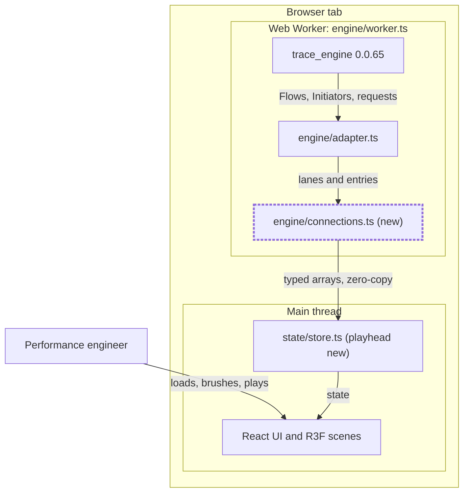
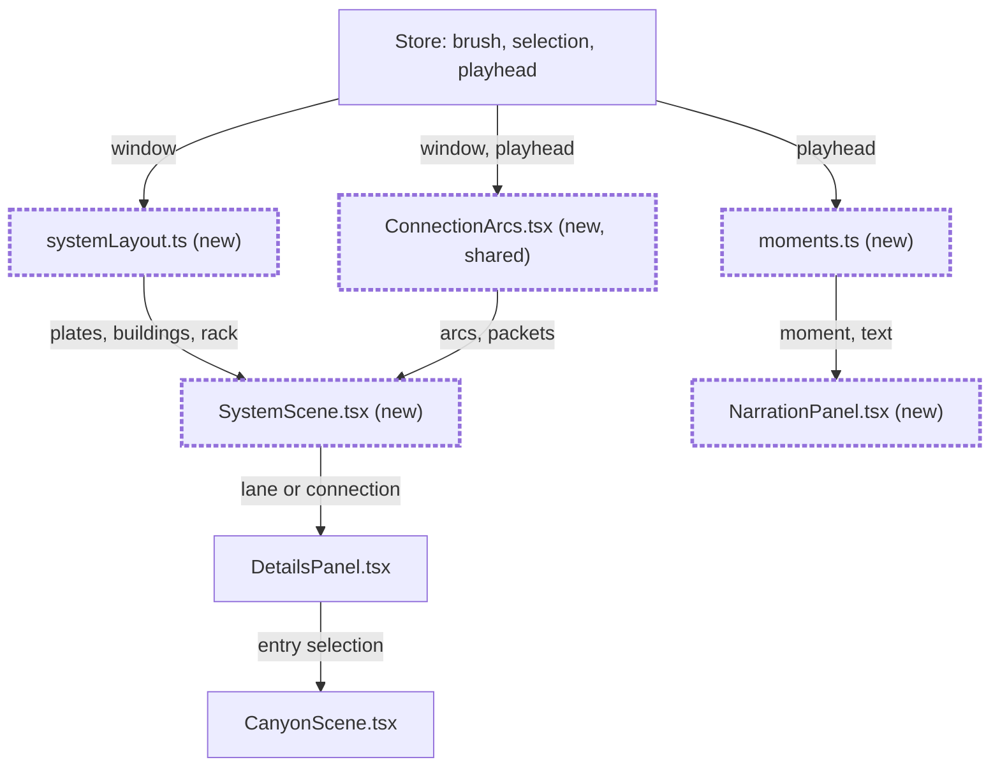
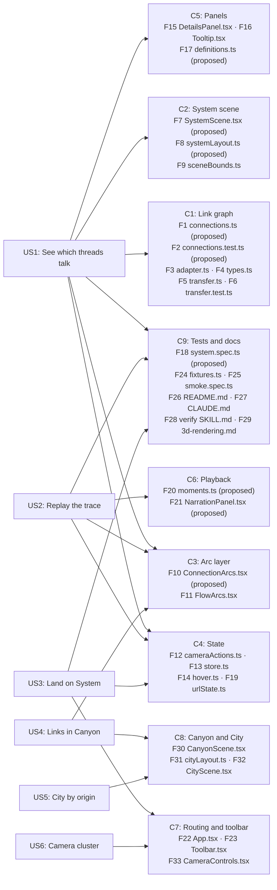

# Connected System view

**Implemented and verified.** See `plan.md` and `notes.md` for completion evidence.

## Summary

Trace Topography shows cost and time well, but it hides which threads and processes talk to each other. This spec adds System, a board view modeled on pgrun.dev's Postgres internals page. Renderer processes become district plates, threads become buildings, and links between threads become arcs. A playhead replays the trace with moving packets and plain narration. Canyon remains the default view, with System third after Terrain. The same link layer then appears in Canyon and City, and the camera controls leave the toolbar.

**Where to start:** Interfaces and Contracts, which fixes the link graph and the new selection kinds. Then Story 1 and Story 2, which define the board and the playback.

## Problem

Performance engineers can see that a thread was busy, but not what triggered the work or what it triggered next. The trace already records these links, and today the app draws them only for one selected entry.

The demo trace holds 827 flow chains, 1,080 initiator pairs, and 42 of 45 requests with a recorded initiator.

## Proposed Approach

The worker builds one link graph per trace during the parse, next to the existing `flows`. The graph travels to the main thread inside the compatibility projection as typed arrays. Every view then reads the same graph. Playback needs per-frame lookups, so the instance arrays must live on the main thread. A worker round trip on every frame would stall the animation.

Each link has a provenance. A link is **recorded** when the trace itself records it, as a flow event or a request initiator. A link is **derived** when trace_engine's `Initiators` handler or a URL match infers it. Recorded links draw solid. Derived links draw dashed.

The board aggregates links per lane pair inside the brush window. Link packets show graph instances in progress at the playhead.
Request activity markers follow request lifetimes on their recorded requester-frame routes. They include requests without a recorded initiator.
The UI labels request activity separately from initiator evidence. Graph intervals and provenance remain unchanged.
Narration and the status line are pure functions of the trace and the playhead.

### Interfaces and Contracts

- **Link graph.** `ParsedTraceModel.connections` holds an edge table and a time-sorted instance table:

  ```ts
  interface ConnectionGraph {
    edges: { fromLane: number; toLane: number; kind: "flow" | "initiator" | "request" | "consumer"; provenance: "recorded" | "derived" }[];
    edgeIds: Uint32Array; starts: Float64Array; ends: Float64Array; // one row per link instance, ms from trace start
    fromIdx: Int32Array; toIdx: Int32Array; // entry index in its lane, or -1 when the endpoint has no entry
    unplaced: number; // links with an endpoint on a lane outside the model
  }
  ```

  A link instance starts at its source entry's start and ends at its target entry's start.
- **Deduplication.** When an initiator pair joins the same two entries as a flow link, the graph keeps one link with recorded provenance.
- **Consumer match.** A `ParseHTML`, `EvaluateScript`, or `ParseAuthorStyleSheet` entry links to the latest request for its URL that started before it. One request can have many consumers.
- **Requests.** `NetworkRequestInfo` gains `initiatorType: string | null` (as recorded) and `requesterLane: number | null` (the Main lane of the requesting frame).
- **Selection.** `TraceSelection` gains `{ kind: "lane"; lane: number }` and `{ kind: "connection"; edge: number }`. Views that cannot show a selection kind keep it and draw nothing for it.
- **View state.** `ViewId` gains `"system"`. The store gains `playhead: number | null`, `playing: boolean`, and `playbackRate: 0.1 | 0.25 | 1`. The URL hash gains `t=<ms>` for the playhead.
- **View order.** The tabs and `Alt+digit` keys run Canyon 1, Terrain 2, System 3, Rhythm 4, City 5, Diff 6, Vitals 7.

## Scope

| | |
| --- | --- |
| **Building** | The link graph, the System board with playback after Terrain, links in Canyon and City, and a camera control cluster. |
| **Not building** | Model calls for narration, because fixed templates cannot overclaim. Bloom or post-processing, because the rendering contract forbids it. Text printed on 3D faces, because labels stay fixed-pixel (D4). The pgrun look in other views, because D3 limits it to System. |
| **Deferred** | GPU frame-pipeline links (compositor to GPU). The demo has none, so build them when a fixture shows them. |

### Path Boundaries

- **Upper bound.** Stories 1 to 6 as written.
- **Lower bound.** Stories 1 to 3, with System after Terrain in the tabs.
- **Implementer's choice.** Narration wording within the observation rule, building footprints, arc curve shape, and the Canyon cap's tie-break order.
- **Prohibited.** Random or time-seeded render values (they break determinism). New categorical hues (they break palette safety).

## Functional Requirements

- FR-001: Build the link graph from flows, initiators, request initiators, and URL-matched consumers, with provenance and deduplication.
- FR-002: Draw System as district plates per renderer process, a GPU plate, a request rack, and one building per visible thread lane.
- FR-003: Draw arcs per lane pair in the brush window. Line style shows provenance and width shows the link count.
- FR-004: Show hover cards and selection for buildings, arcs, and link instances, each resolving to exact entries.
- FR-005: Replay the brush window with a playhead, moving packets, narration, a status line, and moment steps.
- FR-006: Keep Canyon the first tab and the default view. Place System third after Terrain.
- FR-007: Add a Connections toggle to Canyon.
- FR-008: Group City by third-party entity and show caller and callee arcs.
- FR-009: Move camera controls from the toolbar into a cluster beside the minimap.

### Non-Functional Requirements

- NFR-001: The same trace, view, playhead, and viewport produce a byte-identical canvas across reloads.
- NFR-002: System draws the demo at 1440×900 in 12 draw calls or fewer, at rest and while playing. Today Canyon uses 20 and City uses 4.
- NFR-003: The demo reaches a stable default workspace within 3 s, as `tests/e2e/tracer-startup.spec.ts` measures today.
- NFR-004: The median frame interval during playback stays within 10% of the Canyon navigation median measured in the same run.
- NFR-005: Every new control works by keyboard, has an accessible name, and meets WCAG 2.2 AA contrast. Layouts at 375 px have no horizontal overflow.

## Architecture Views

The worker adds one module, and the main thread adds one view that reads its output. Figure 1 shows the containers.



*Figure 1: Container view. Boxes are containers or modules. Subgraphs are execution boundaries. Dashed borders mark new modules.*

Inside the System view, one layout function and one arc layer feed the scene, and the playhead drives three outputs. Figure 2 shows the components.



*Figure 2: Component view of System. Arrows carry the named data. Dashed borders mark new components.*

## User Stories

Acceptance criteria carry an ID like `AC-1.2`, meaning story 1, criterion 2. Read the sentence, not the ID.

### Story 1: See which threads talk to each other

**As a** performance engineer, **I want to** see a trace's processes, threads, and links on one board, **so that** I can follow work across threads.

- [x] A user who opens the demo on System sees plates for monkeykode.com, challenges.cloudflare.com, and vercel.live, a GPU plate, and a rack of 45 request slabs. (AC-1.1)
  - Passes when: each visible thread lane has one building whose height follows busy time in the brush window.
  - Fails when: the user hides a lane in the track picker, and its building and arcs remain.
- [x] A user who hovers an arc sees its lanes, link count, kind, and provenance. (AC-1.2)
  - Passes when: Main on monkeykode.com to the ThreadPool lane with thread ID 15363 reads 23 recorded links, drawn solid.
  - Fails when: a duplicate initiator doubles that count, or a derived arc such as vercel.live to monkeykode.com (5 links) draws solid.
- [x] A user who brushes a window sees heights and arcs for that window only. A window without links states "No links in this window". (AC-1.3)
- [x] A user who hovers a building sees its thread role, busy time, top three activities, and link counts in and out, including links within the thread. (AC-1.4)
  - Passes when: a reviewed definition exists, and the card shows it with its source link.
  - Fails when: no reviewed definition exists. The card then states "No reviewed definition", never invented text.
- [x] A user who clicks a building selects its lane. "Open in Canyon" switches to Canyon and fits the camera to that lane. Escape clears the selection. (AC-1.5)
- [x] A user who clicks an arc sees its link instances with times and endpoints. Clicking an instance selects its source entry in Canyon. (AC-1.6)
  - Fails when: an endpoint has no entry. The row then says "Endpoint not recorded" and cannot be selected.
- [x] A user with a selection sees unrelated buildings and arcs dim to outlines. (AC-1.7)
- [x] A user sees how many links reach threads outside the model, for example "4 links reach threads not loaded". (AC-1.8)

### Story 2: Replay the trace on the board

**As a** performance engineer, **I want to** play the trace across the board, **so that** I can see the order in which work moves.

- [x] A user who presses Play sees the playhead advance through the brush window at 0.1x, 0.25x, or 1x. Pause holds the frame. (AC-2.1)
- [x] A user at `#view=system&t=34.24` on the demo sees Main on monkeykode.com active, 19 packets on its arc to the request rack, and narration that says 19 requests are in flight. (AC-2.2)
  - Fails when: `t` falls outside the brush window. The playhead then clamps to the nearest window edge.
- [x] A user steps between moments with Previous and Next moment buttons and the `,` and `.` keys. Moments are navigation start, first request, FCP, LCP, each long task of 50 ms or more, and each finding. (AC-2.3)
  - Fails when: the user is at the last moment. Next moment is then disabled.
- [x] A user reads narration that states recorded names, durations, and counts only. (AC-2.4)
  - Fails when: a template contains causal words such as "because", "caused", or "due to".
- [x] A user with reduced motion sees Play step from moment to moment, with packets as still markers. (AC-2.5)
- [x] A user who pauses sees the renderer stop drawing frames. (AC-2.6)
- [x] A user sees a status line with playhead time, busy threads, requests in flight, and load phase. (AC-2.7)
- [x] A user sees at most 512 packets at once. When more links are in progress, a note states how many are not drawn. (AC-2.8)

### Story 3: Land on Canyon and explore System

**As a** performance engineer, **I want** Canyon first, Terrain second, and System third, **so that** I can inspect timing before exploring thread relationships.

- [x] A user who loads a single trace without a view in the URL lands on Canyon, the first tab. `Alt+1` opens Canyon, `Alt+2` opens Terrain, and `Alt+3` opens System. (AC-3.1)
  - Fails when: the hash names another view. `#view=system` opens System, and an unknown view opens Canyon.
- [x] A user who imports an experiment still lands on the regression view. (AC-3.2)

### Story 4: See links in Canyon

**As a** performance engineer, **I want to** show links in Canyon, **so that** I can follow work at entry level.

- [x] A user who turns on Connections sees arcs between displayed entries, solid or dashed by provenance. The toggle is off by default. (AC-4.1)
- [x] A user sees at most 200 arcs at once, chosen in a stable order, with a note such as "200 of 812 links shown". (AC-4.2)
  - Fails when: links are dropped without the note.
- [x] A user who hovers an arc that ends on an aggregated span sees that it ends on an aggregate. (AC-4.3)

### Story 5: See City grouped by origin

**As a** performance engineer, **I want** City grouped by origin, **so that** I can tell first-party work from third-party and extension work.

- [x] A user sees City buildings grouped into district plates by entity, plus an "Unattributed" district. Each building is one activity within one entity. (AC-5.1)
  - Passes when: clicking a building selects its activity name, and every district highlights that name.
- [x] A user who hovers or selects a building sees dashed arcs to its top 8 callers and callees by inclusive time. (AC-5.2)

### Story 6: Reach camera controls without a crowded toolbar

**As a** performance engineer, **I want** camera controls beside the minimap, **so that** the toolbar holds only trace actions.

- [x] A user finds every camera control beside the minimap, with its old accessible name. The toolbar keeps view tabs, stats, Load trace, Compare, scale, tracks, and inspector. (AC-6.1)
- [x] A user at 375 px opens the camera cluster from one Camera button, with no horizontal overflow. (AC-6.2)

## Story-to-file Mapping

These are provisional expected touch points. Task planning determines task order and final files. Paths are relative to the repository root.

| Story | Component | Expected file / touch point | Status | Change purpose |
| --- | --- | --- | --- | --- |
| US1: See which threads talk | C1: Link graph | F1: `src/engine/connections.ts` | Proposed new | Build edges, instances, deduplication, and consumer match |
| US1 | C1 | F2: `src/engine/connections.test.ts` | Proposed new | Pin demo counts and endpoint validity |
| US1 | C1 | F3: `src/engine/adapter.ts` | Existing | Read initiators and request initiators at the cast boundary |
| US1 | C1 | F4: `src/engine/types.ts` | Existing | Add `ConnectionGraph` and request fields |
| US1 | C1 | F5: `src/engine/transfer.ts` | Existing | Transfer the new typed arrays |
| US1 | C1 | F6: `src/engine/transfer.test.ts` | Existing | Prove the new buffers detach |
| US1 | C2: System scene | F7: `src/scene/SystemScene.tsx` | Proposed new | Draw plates, buildings, rack, and picking |
| US1 | C2 | F8: `src/scene/systemLayout.ts` | Proposed new | Deterministic layout |
| US1 | C2 | F9: `src/scene/sceneBounds.ts` | Existing | Export System bounds |
| US1 | C3: Arc layer | F10: `src/scene/ConnectionArcs.tsx` | Proposed new | Shared arcs and packets |
| US1 | C3 | F11: `src/scene/FlowArcs.tsx` | Existing | Fold into the shared arc layer |
| US1 | C4: State | F12: `src/scene/cameraActions.ts` | Existing | Add lane and connection selection kinds |
| US1 | C4 | F13: `src/state/store.ts` | Existing | Selection handling for new kinds |
| US1 | C4 | F14: `src/state/hover.ts` | Existing | Add the System hover source |
| US1 | C5: Panels | F15: `src/ui/DetailsPanel.tsx` | Existing | List arc instances and lane details |
| US1 | C5 | F16: `src/ui/Tooltip.tsx` | Existing | Building and arc hover cards |
| US1 | C5 | F17: `src/evidence/definitions.ts` | Proposed new | Thread role definitions in T041's planned path |
| US1 | C9: Tests and docs | F18: `tests/e2e/system.spec.ts` | Proposed new | Picking, linking, pixels, draw calls |
| US2: Replay the trace | C4 | F13: `src/state/store.ts` | Existing | Playhead, playing, and rate |
| US2 | C4 | F19: `src/lib/urlState.ts` | Existing | Round-trip `t=` |
| US2 | C6: Playback | F20: `src/engine/moments.ts` | Proposed new | Moments, narration, and status text |
| US2 | C6 | F21: `src/ui/NarrationPanel.tsx` | Proposed new | Narration, status line, and play controls |
| US2 | C3 | F10: `src/scene/ConnectionArcs.tsx` | Proposed new | Packets at the playhead |
| US2 | C9 | F18: `tests/e2e/system.spec.ts` | Proposed new | Playback, reduced motion, idle |
| US3: Land on System | C7: Routing | F22: `src/App.tsx` | Existing | Default view and key map |
| US3 | C7 | F23: `src/ui/Toolbar.tsx` | Existing | Tab order |
| US3 | C4 | F19: `src/lib/urlState.ts` | Existing | View list and fallback |
| US3 | C9 | F24: `tests/e2e/fixtures.ts` | Existing | Boot Canyon tests with `#view=canyon` |
| US3 | C9 | F25: `tests/e2e/smoke.spec.ts` | Existing | Expect System on load |
| US3 | C9 | F26: `README.md` | Existing | Key list |
| US3 | C9 | F27: `CLAUDE.md` | Existing | View list |
| US3 | C9 | F28: `.claude/skills/verify/SKILL.md` | Existing | View keys |
| US3 | C9 | F29: `docs/3d-rendering.md` | Existing | System rendering contracts |
| US4: Links in Canyon | C8: Canyon and City | F30: `src/scene/CanyonScene.tsx` | Existing | Connections toggle and cap |
| US4 | C3 | F10: `src/scene/ConnectionArcs.tsx` | Proposed new | Entry-level arcs |
| US5: City by origin | C8 | F31: `src/scene/cityLayout.ts` | Existing | Entity districts |
| US5 | C8 | F32: `src/scene/CityScene.tsx` | Existing | Plates and caller arcs |
| US6: Camera cluster | C7 | F33: `src/ui/CameraControls.tsx` | Existing | Move into the cluster |
| US6 | C7 | F23: `src/ui/Toolbar.tsx` | Existing | Remove camera rows |

### Story traceability view

Each story points to the components it changes, and each component node lists its expected files. Figure 3 shows the links.



*Figure 3: Traceability. Arrows run from a story to the components it changes. "(proposed)" marks new files.*

## Acceptance Criteria

- [x] Reloading the same trace at the same view, playhead, and viewport yields a byte-identical canvas, for System at rest and at `t=34.24`. (AC-0.1)
- [x] Every link instance in the demo has endpoints that are `-1` or a valid entry in their lane. (AC-0.2)
- [x] System on the demo draws in 12 draw calls or fewer, at rest and while playing. (AC-0.3)
- [x] The demo reaches a stable workspace on System within 3 s. (AC-0.4)
- [x] The playback median frame interval stays within 10% of the Canyon navigation median in the same run. (AC-0.5)
- [x] Every new control is reachable by Tab, has an accessible name, and meets AA contrast. Layouts at 375 px have no horizontal overflow. (AC-0.6)
- [x] `pnpm build`, `pnpm lint`, `pnpm test`, and `pnpm test:e2e` pass. (AC-0.7)

## Test Seams

- Vitest parses the demo through the real trace_engine, modeled on `src/engine/adapter.test.ts`. Verifies AC-1.2 counts and AC-0.2.
- `src/engine/transfer.test.ts` proves the new buffers transfer and detach.
- Pure-function unit tests for `systemLayout.ts` and `moments.ts`, modeled on `src/scene/picking.test.ts` and `src/engine/vitals.test.ts`. Verify AC-1.3, AC-2.3, and AC-2.4.
- Playwright with real pointer events, modeled on `tests/e2e/visualization.spec.ts`. Its pixel-identical reload test is the model for AC-0.1.
- `tests/e2e/render-performance.spec.ts` reads `gl.info.render.calls` and frame intervals. Verifies AC-0.3 and AC-0.5.
- `tests/e2e/tracer-startup.spec.ts` verifies AC-0.4. `tests/e2e/camera-idle-accessibility.spec.ts` is the model for AC-2.5 and AC-2.6.

## Technical Constraints

- trace_engine data enters only through the `EngineData` interface in `adapter.ts`. Times convert from µs to ms only there.
- The worker keeps parse requests strictly serialized.
- Data materials stay unlit, with no lights or tone mapping on the data path. Labels stay fixed-pixel DOM overlays.
- The active state uses ink white, because the UI accent `#3987e5` equals the Loading color.
- System buildings retain their dominant category color in overview and playback. The dominant category uses exclusive busy time in the brush window.
- White outlines mark current activity. Blue request slabs, category labels, and the legend explain the board without relying on color alone.
- The renderer draws on demand and animates only while playing.

## Assumptions

- The key order follows the tab order. Canyon keeps `Alt+1`, Terrain uses `Alt+2`, and System uses `Alt+3`.
- The link graph rides in the compatibility projection until T055 moves views to worker projections. If T055 lands first, System requests its aggregates from the worker and keeps instance arrays on the main thread.
- T041 has not landed. This work creates `src/evidence/definitions.ts` in T041's planned shape, with thread role entries only.

## Alternatives Considered

| Alternative | Why not |
| --- | --- |
| Rebuild City as the board | It loses the bottom-up skyline that answers "what costs the most". |
| Compute System only in the worker | Playback would cross the worker boundary on every frame. |
| Draw one arc per link instance | 100,000 arcs are unreadable. Aggregation per lane pair keeps the board legible. |
| Bloom for the active glow | It breaks the no-post-processing rule and hides thin data. |

## Risks

| Risk | Likelihood | Impact | What we do about it |
| --- | --- | --- | --- |
| Busy time spans 1 ms to 600 ms, so linear height hides helper threads. | High | Med | Apply a minimum height and the existing log scale. |
| A URL match ties a request to the wrong consumer. | Med | Med | Draw consumer links dashed and name the match rule in the hover card. |
| Many requests in flight crowd the arc with packets. | Med | Low | Cap packets at 512 and state how many more are in flight. |
| Default-view changes break saved view links. | High | Low | Verify Canyon on fresh load and preserve explicit view hashes. |
| T055 rewrites City at the same time as Story 5. | Med | Med | Build Story 5 on T055 if it lands first. |

## Blockers

- None. All six stories are complete.

## Resolved Decisions

These were open in the plan review on 2026-10-16. The source plan is `../connected-system-plan.md`.

### Where the connected board lives

**Decision:** a new System view. City stays the bottom-up skyline.

City answers "what costs the most". System answers "what talks to what". One view cannot carry both encodings.

### How the board shows time

**Decision:** a playhead with moment steps and narration.

A static map loses the order of events, and moments alone lose the motion between them.

### How far the pgrun look reaches

**Decision:** System only. Revisit the other views after use.

### Where text sits

**Decision:** fixed-pixel DOM plaques. Text printed on faces shrinks and foreshortens at distance.

### Toolbar cleanup

**Decision:** in scope as Story 6.

### Landing view

**Decision:** Canyon is the first tab and the default view. System comes third after Terrain, following the user's latest deployment feedback.
Experiment imports still open on the regression view, as FR-009 of the root `spec.md` requires.

### Request playback

**Decision:** use request activity markers for the 19 requests in flight at 34.24 ms.
The user approved this through `.lavish/connected-system-packets.html` during implementation.
The document request has no recorded initiator. Its activity marker uses the recorded requesting frame without inventing an initiator link.
